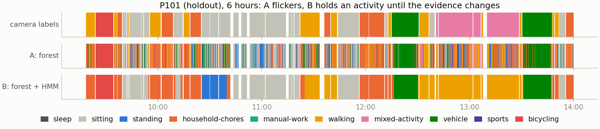
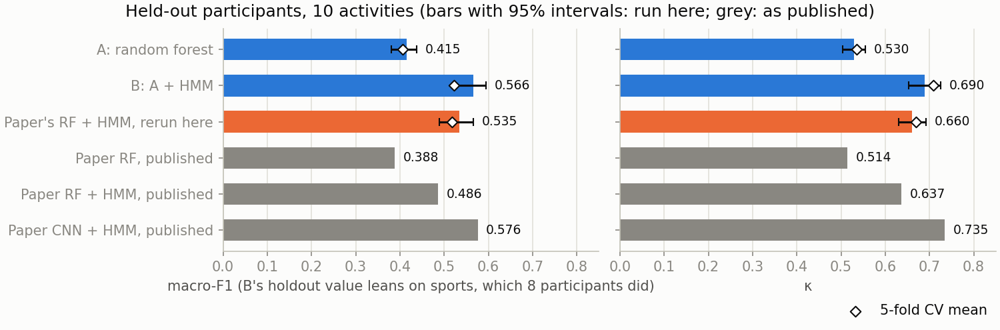

# Recognising daily activities from a wrist sensor

Reproduces the CAPTURE-24 random forest + HMM benchmark from the authors' code (κ 0.660 against 0.637 published), measures two evaluation pitfalls, and edges the reproduced baseline by 0.04 κ.

A wrist accelerometer records 24 hours of movement. Can we tell what its wearer was doing in every 10 seconds? It is hard because the recordings come from people's normal days, not scripted lab sessions, and the labels come from camera photos taken every 20–40 seconds.

This project classifies 10 activities (sleep, sitting, standing, household chores, manual work, walking, mixed activity, vehicle, sports, bicycling) on [CAPTURE-24](https://doi.org/10.5287/bodleian:NGx0JOMP5), 151 people wearing a wrist sensor for a day each. Everything is in [`capture24_har.ipynb`](capture24_har.ipynb).

Two models: **A**, a random forest on 39 hand-made features of each 10 s window, and **B**, the same forest with a hidden Markov model (HMM) that smooths its output over time. Six hours of one held-out participant show what the smoothing does:

## Result

| 5-fold cross-validation, same folds (mean ± spread over folds) | Macro-F1 | κ |
|---|---|---|
| A: random forest | 0.406 ± 0.017 | 0.535 ± 0.014 |
| The paper's random forest + HMM, rerun here | 0.517 ± 0.041 | 0.670 ± 0.030 |
| B: random forest + HMM | 0.522 ± 0.033 | 0.708 ± 0.025 |

Macro-F1 is the average score per activity, so rare activities count as much as sleep. κ is agreement with the labels beyond what chance would give.

On the paper's 51 held-out participants the rerun scores κ 0.660, a little above the 0.637 the paper ([Chan et al., 2024](https://doi.org/10.1038/s41597-024-03960-3)) reports, so it is a fair bar. B is 0.029 κ above it there (95% interval 0.001 to 0.058, paired by participant); the macro-F1 difference is not reliable. B's held-out macro-F1 leans on sports, which only 8 of those participants did, so its cross-validation figure is the safer one to quote. The paper's deep model is above B on both metrics.

## Finding

Paired by fold, B is 0.039 κ above the rerun of the paper's pipeline (standard error 0.013) and level with it on macro-F1 (+0.005, standard error 0.014). No single choice tested explains the gain. Each moves κ by 0.002–0.012, and together they account for about half of it.

Two pitfalls turned up on the way, both measured in the notebook:

- Splitting sequences where annotation stops tells the HMM where activities begin and end. It adds 0.02 macro-F1 that a deployed model would not get.
- If you fit anything on the out-of-bag output of imblearn's balanced forest, check coverage. With 300 trees, 29% of the majority-class windows get none, and they are silently averaged in as zeros. An HMM fitted on that output loses 0.075 κ; with the paper's 3,000 trees every window is covered.

## What keeps it honest

- Window counts match the paper's exactly (922,199 in total).
- Cross-validation is grouped by participant, and the HMM is fitted on training participants only.
- The rerun of the paper's pipeline was configured from the paper's code before any score was seen, and run once.
- B decodes each full recording, including unlabelled stretches, and is scored on labelled windows only.
- Holdout intervals resample participants, not windows, and the holdout comparison with the rerun is paired by participant.

## Limitations

- **Label noise.** Labels come from camera frames 20–40 s apart plus sleep diaries. Manual work is mostly read as household chores and mixed activity as walking, and the labels themselves overlap.
- **A small edge.** The gain over the paper's pipeline is 0.04 κ on five folds, with none in macro-F1.
- **B's design was chosen on those folds** over several versions, while the rerun was run once. That favours B slightly in cross-validation; the paired holdout difference is the check against it.
- **Not the paper's exact run.** The rerun uses this project's feature code (30 of the paper's 32 features), fits the 3,000 trees as five forests of 600, and uses default forest settings.
- **An open feature question.** With 30 features instead of 39, B gains 0.037 macro-F1 in cross-validation, mostly in sports. B keeps 39 because the holdout was already scored with them.
- **One cohort.** All 151 participants were recruited around Oxford.
- **The holdout was scored twice for B,** once with an earlier version. Every change in between was chosen on cross-validation.

## Reproduce

Tested with Python 3.13 on a machine with 16 GB of memory and 8 logical cores.

1. Download `capture24.zip` (6.9 GB, or 6.4 GiB) from <https://doi.org/10.5287/bodleian:NGx0JOMP5> into `data/`.
2. `pip install -r requirements.txt`. The versions are pinned on purpose: the rerun of the paper's pipeline relies on how imbalanced-learn 0.13.0 and scikit-learn 1.6.1 compute out-of-bag output.
3. `jupyter nbconvert --execute --to notebook --inplace capture24_har.ipynb`

Check: the window-count table near the top should read 922,199 in both columns.

A run takes about 11 min on 8 logical cores once both caches in `data/` exist. The first run also builds the feature cache (about 9 min) and the rerun of the paper's pipeline (about 18 min).

## Outputs

- `outputs/results.json`: every score for the 10-class and 4-class tasks (macro-F1, κ and MCC; cross-validation and holdout), the rerun of the paper's pipeline, and the ablation.
- `outputs/holdout_predictions.csv`: one row per labelled holdout window for B. `y_pred` is the most likely sequence; the probability columns are the HMM's per-window posterior, so their largest value can differ from `y_pred` (it agrees for 98.7% of windows). Columns are in alphabetical class order.
- `outputs/holdout_proba.npy`: the same probabilities at full precision.

## Licence

The CAPTURE-24 data is CC BY 4.0; credit Chan et al. (2024) when using it. It is not included in this repository. The code is under the MIT licence, in [`LICENSE`](LICENSE).
