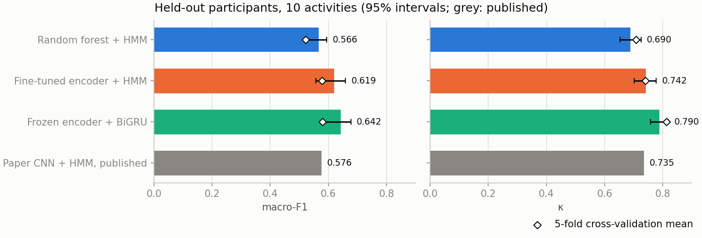
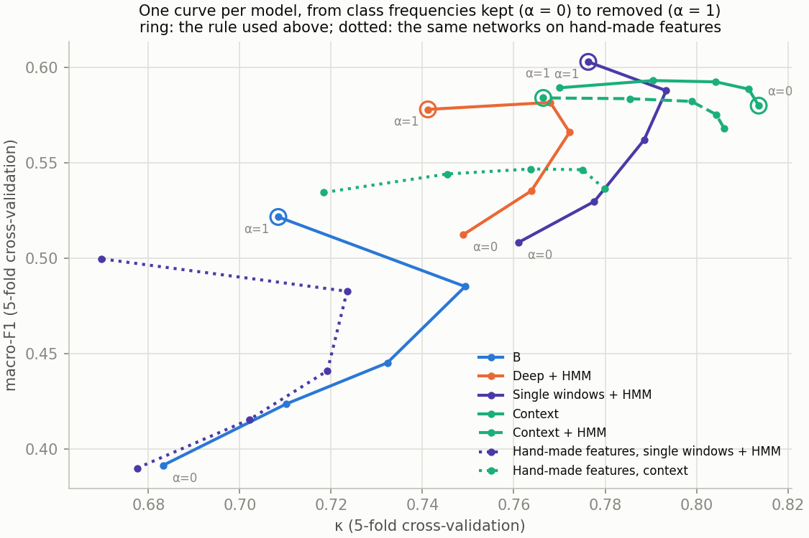

# Recognising daily activities from a wrist sensor

Reproduces the CAPTURE-24 random forest + HMM benchmark from the authors' code (κ 0.660 against 0.637 published), measures two evaluation pitfalls and one labelling artefact, and reaches κ 0.790 on held-out participants with a frozen pretrained encoder and a small recurrent network (+0.064 κ over our random forest + HMM in cross-validation, with each model at its best decision rule).

A wrist accelerometer records 24 hours of movement. Can we tell what its wearer was doing in every 10 seconds? It is hard because the recordings come from people's normal days, not scripted lab sessions, and the labels come from camera photos taken every 20–40 seconds.

The data is [CAPTURE-24](https://doi.org/10.5287/bodleian:NGx0JOMP5): 151 people wearing a wrist sensor for a day each, labelled with 10 activities (sleep, sitting, standing, household chores, manual work, walking, mixed activity, vehicle, sports, bicycling). The last 51 participants are held out, as in the paper ([Chan et al., 2024](https://doi.org/10.1038/s41597-024-03960-3)).

Six hours of one held-out participant: the camera labels, a random forest that judges each 10 s window alone (A), and the same forest smoothed over time by a hidden Markov model (B).


## Three findings

**1. Result.** The best model here is a pretrained encoder, used frozen, with a small recurrent network that reads consecutive windows ("Context").

Macro-F1 is the average score per activity, so rare activities count as much as sleep. κ is agreement with the labels beyond what chance would give.

| Held-out participants [95% interval] | Macro-F1 | κ |
|---|---|---|
| The paper's random forest + HMM, rerun here | 0.535 [0.490, 0.566] | 0.660 [0.630, 0.692] |
| B: random forest + HMM | 0.566 [0.524, 0.595] | 0.690 [0.653, 0.725] |
| Deep + HMM: the encoder fine-tuned, + HMM | 0.619 [0.557, 0.659] | 0.742 [0.702, 0.778] |
| Context: the encoder frozen, + recurrent network | 0.642 [0.577, 0.677] | 0.790 [0.758, 0.819] |
| Context minus B, paired by participant | +0.076 [0.021, 0.111] | +0.100 [0.076, 0.124] |
| The paper's CNN + HMM, as published (not paired) | 0.576 | 0.735 |

| Context's κ gain, cross-validation | Over B | Over Deep + HMM |
|---|---|---|
| At the decision rules used on the held-out participants | +0.105 | +0.072 |
| With each model at its best rule for κ | +0.064 | +0.041 |

Each model was scored at the decision rule the protocol fixed for it: Context keeps the class frequencies in its output, the HMM models have them divided out. Putting each model at its best rule shrinks the gains by about 40%, so read +0.100 as an upper figure.



The encoder and the context both matter, and they overlap. In cross-validation, with each model at its best rule for κ, the encoder's output beats B's 39 hand-made features by 0.070 under the same single-window network and HMM and by 0.034 under the same context network; context adds 0.056 on the hand-made features and 0.020 on the encoder, and needs no HMM. With the one fine-tuning recipe tried, the frozen encoder is 0.021 above the fine-tuned one at each model's best rule. No model gets much past macro-F1 0.60.

**2. A fact about the labels.** Annotators leave an unlabelled gap at almost every change of activity: of 609,580 adjacent pairs of labelled windows in P001–P100, 46 are two different activities. So the labels cannot say how often people switch activity. The HMM's transition matrix comes out close to "never switch", with a cost set by a numerical floor and not by data. The HMM appears to act as a flicker filter, and the recurrent network makes it redundant.

**3. Unsolved.** Rare activities and unusual days. Manual work and mixed activity are at F1 0.3 or below in cross-validation. One participant who spent ten hours in a vehicle scores κ 0.32 to 0.39 whatever the model.

**How to read the scores.** Every score is on labelled windows, and labelled windows almost never sit on a change of activity, so the scores describe the inside of bouts; on continuously labelled data they would be lower. Cross-validation ± figures are over five folds that share most of their training participants, so they understate the uncertainty; the paired bootstraps over held-out participants are the inference to lean on.

## The work, in order

Part 1 is [`capture24_har.ipynb`](capture24_har.ipynb); part 2 is [`capture24_new_model.ipynb`](capture24_new_model.ipynb).

**Reproduction (part 1).** Window counts match the paper's exactly (922,199). The paper's random forest + HMM, rerun from the authors' code, scores κ 0.660 on the held-out participants against 0.637 published, so it is a fair baseline.

**Two pitfalls, measured (part 1).**

- Splitting sequences where annotation stops tells the HMM where activities begin and end. It adds 0.02 macro-F1 that a deployed model would not get.
- If you fit anything on the out-of-bag output of imblearn's balanced forest, check coverage. A majority-class window is out-of-bag for about trees × (smallest class ÷ its class) × 0.37 trees. Here that ratio is about 1/85, so with 300 trees 29% of sleep and sitting windows get none and are averaged in as rows of zeros. An HMM fitted on that output loses 0.075 κ. imblearn warns, but not how many windows are affected or that their rows become zeros.

**B (part 1).** A balanced random forest on 39 features per window, with an HMM over its probabilities. In 5-fold cross-validation B is 0.039 κ above the rerun of the paper's pipeline (standard error 0.013) and level on macro-F1. On the held-out participants the paired difference is +0.029 κ (0.001 to 0.058): a small gain and no more.

**Where B's errors are (part 2).** Uncertain label timing explains at most 0.03 κ, partly because annotators had already cut the uncertain moments out as gaps; two thirds of the errors are more than a minute from any label change. That led to the label-gap finding above. The cost of a switch the labels never showed is a floor of 1e-16; over twenty orders of magnitude of that floor κ moves by 0.02 for B and 0.03 for the fine-tuned model, comparable to B's held-out gain of 0.03 over the paper's pipeline. An explicit switching rate gives the same scores from 1 in 1,000 to 1 in 100 million windows and does not beat the counted matrix. So the smoother is not the bottleneck: errors on bouts of a few minutes come from the classifier.

**A pretrained encoder (part 2).** The authors' self-supervised encoder, [`ssl-wearables`](https://github.com/OxWearables/ssl-wearables) (Yuan et al., 2024), fine-tuned on the same folds with B's HMM, beats B on both metrics and matches the paper's deep model. Over three fine-tuning seeds its gain over B stays positive.

**Context, the decision rule, and what the encoder is worth (part 2).** A recurrent network over the frozen encoder's output for consecutive windows reads minutes instead of 10 seconds. Each model's scores depend on how much of the class frequencies its decision rule keeps: keeping them favours common activities and κ, removing them favours rare activities and macro-F1 (with them kept, B never predicts manual work at all). The figure shows every model along that whole trade-off, on cross-validation, including the same two networks on B's hand-made features.



Best κ in cross-validation: Context 0.814, B 0.749; the notebook has the rest.

## Try it

```
python scripts/predict.py recording.csv.gz --out results/
```

writes a timeline CSV and a picture of the day from a raw recording (100 Hz, in g, columns `time, x, y, z`), using the Context model in `models/context_v1.pt`. `--rule balanced` trades some agreement for more of the rare activities. It was validated only on CAPTURE-24's input: an Axivity AX3 on the wrist, ±8 g, adults around Oxford; it stops if the samples are not 10 ms apart. The model file is stored with Git LFS, so clone with Git LFS installed (or run `git lfs pull`). The first run downloads the encoder from its authors.

## What keeps it honest

- Cross-validation is grouped by participant, and everything fitted (forest, HMM, networks, early stopping) uses training participants only.
- The rerun of the paper's pipeline was configured from the paper's code before any score was seen, and run once.
- Models decode each full recording, including unlabelled stretches, and are scored on labelled windows only.
- Held-out intervals resample participants, not windows, and comparisons between models are paired by participant.
- For each new model the settings, the candidates and the selection rule were written down before any score, and the held-out participants were scored once.
- The shared code (folds, HMM, metrics, bootstraps) is in `scripts/har.py`, and both notebooks check that B reproduces the same scores.

## Limitations

- **The held-out participants have been used five times:** B twice (once with an earlier version), the paper's rerun, Deep + HMM and Context. Every choice in between was made on cross-validation, and the models compared afterwards (the single-window control, the hand-made-feature networks, the decision-rule curves) were scored in cross-validation only.
- **Selection on the same folds.** B's design, the fine-tuned combination and the context candidate were chosen on the folds whose scores are reported, which favours them slightly there.
- **Held-out macro-F1 leans on a few activities** that only some of the 51 participants did (8 did sports). The cross-validation figures, 0.52 for B and 0.58 for Context, are the safer ones to quote (a mean over folds, where the held-out figure is pooled).
- **Label noise.** Labels come from camera frames 20–40 s apart plus sleep diaries, and some classes overlap: manual work with household chores, mixed activity with walking.
- **Not the paper's exact run.** The rerun uses this project's feature code (30 of the paper's 32 features), fits the 3,000 trees as five forests of 600, and uses default forest settings.
- **One seed on the held-out participants.** Three seeds were run on cross-validation only; the spread there is about 0.01.
- **One fine-tuning recipe.** "Frozen beats fine-tuned" is about learning rate 1e-4 with early stopping after one or two epochs; a gentler schedule was not tried.
- **The transition matrix is an accident of the labels.** It helps here, on labels made the same way; it may not on continuously labelled data.
- **One cohort, one device.** All 151 participants were recruited around Oxford and wore an Axivity AX3; the encoder was pretrained on UK Biobank, which used the same device.

## Reproduce

Tested with Python 3.13 on a machine with 16 GB of memory, 8 logical cores and an RTX 2070 SUPER (8 GB).

1. Download `capture24.zip` (6.9 GB) from <https://doi.org/10.5287/bodleian:NGx0JOMP5> into `data/`.
2. Install and register the kernel both notebooks ask for:
   ```
   pip install -r requirements.txt
   python -m ipykernel install --user --name capture24
   ```
   The versions are pinned on purpose: the rerun of the paper's pipeline relies on how imbalanced-learn 0.13.0 and scikit-learn 1.6.1 compute out-of-bag output. PyTorch 2.14.1 comes with CUDA 12.6.
3. Part 1, CPU only: `jupyter nbconvert --execute --to notebook --inplace capture24_har.ipynb`. Check: the window-count table near the top should read 922,199 in both columns. A run takes about 11 min once the caches in `data/` exist; the first run also builds the feature cache (9 min) and the rerun of the paper's pipeline (18 min).
4. Part 2, with a GPU: `jupyter nbconvert --execute --to notebook --inplace capture24_new_model.ipynb`. Every fit is cached in `data/fits/` under a name that ends in a hash of its settings, so changing a setting refits rather than reusing a stale result. The first run resamples the data to 30 Hz, computes the encoder's output for every window and fits 21 fine-tuned encoders (about 9 min each) and 66 recurrent networks (3–5 min each). After that a run takes about 15 min.
5. The command-line tool: `python scripts/train_context.py` refits and saves the Context model (a few minutes), then `python scripts/predict.py`.

## Files

- `capture24_har.ipynb`, `capture24_new_model.ipynb`: the two notebooks.
- `scripts/`: `features.py` (windows and features), `har.py` (folds, forest, HMM, metrics, bootstraps), `deep.py` (encoder, fine-tuning, context model), and the command-line tool, `train_context.py` and `predict.py`, which uses `models/context_v1.pt`.
- `outputs/results.json`, `outputs/results_new_model.json`: every score, for part 1 and part 2.
- `outputs/holdout_predictions.csv`, `outputs/holdout_proba.npy`: B's predictions for every labelled held-out window. `y_pred` is the most likely sequence; the probability columns are the HMM's per-window posterior, so their largest value can differ from `y_pred` (it agrees for 98.7% of windows).

## Licence

- The code is under the MIT licence, in [`LICENSE`](LICENSE).
- The CAPTURE-24 data is CC BY 4.0; credit Chan et al. (2024). It is not included here.
- The `ssl-wearables` encoder is under the University of Oxford's Academic Use Licence (non-commercial academic research; no redistribution). It is not included here: the code downloads it from its authors, pinned to a commit.
